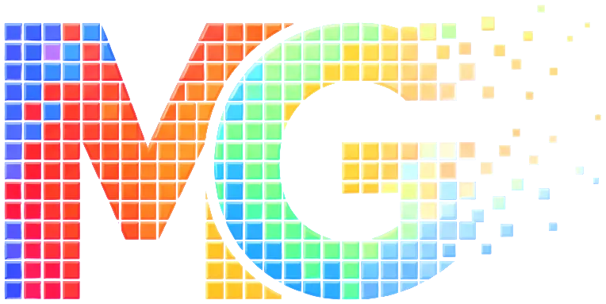

<p align="center"></p>

# MosaicGone

MosaicGone is an Android application for on-device image and video restoration. It locates regions degraded by
pixelation (mosaic, block averaging) in photos, animated GIFs and videos, and reconstructs them with a temporal video
restoration network, for both camera footage and animation. All processing runs locally on the phone: no account, no
upload and no network access (the app does not request the internet permission).

Version 0.5 · Android 10 or newer · 64-bit and 32-bit ARM phones · License: AGPL-3.0

## Research context

The project studies how far recent restoration methods can be brought to ordinary phones:

- **Detection and restoration of block-averaged regions.** A YOLOX-Nano detector with a mask head segments pixelated
  regions; a BasicVSR++ recurrent network reconstructs them from neighbouring frames.
- **Knowledge distillation for low-power devices.** MosaicGone's own restorer (32 channels, 5 blocks) is distilled from
  a larger BasicVSR++ teacher (64 channels, 15 blocks) and fine-tuned with perceptual and adversarial losses; it runs
  about 2x faster than the teacher on phones.
- **Mobile inference engineering.** ONNX Runtime on ARM CPUs, temporally consistent chunked processing, and full-precision
  10-bit/HDR video input.
- **Robustness of pixelation as a privacy measure.** How much detail a learned model can recover from block averaging
  bears on whether mosaics are a sufficient way to anonymise images; see the responsible-use section below.

Models, training data and evaluation are documented in [`MODELS.md`](MODELS.md) and
[`model-development/`](model-development/README.md).

## Responsible use

MosaicGone is intended for restoring images and video you own or are licensed to process, and for research on image
restoration and on the limits of pixelation.

- Do not use it to reveal people, faces, text or other details that were pixelated to protect someone's privacy or
  identity.
- Do not use it on intimate or sexual imagery of any person without their consent, or to create such imagery.
- Results are reconstructions, not recoveries of the original: they are plausible estimates and can contain errors or
  invented detail. Do not treat them as evidence of what was hidden.
- You are responsible for complying with the laws that apply to you and to the material you process.

## Features

- **Photos, GIFs and videos.** Pick from the Gallery, or from Files: any folder, SD card, USB drive or cloud app.
- **Two restoration models:**
  - **BasicVSR++, Scaled (32 channels, 5 blocks):** MosaicGone's own model, trained to be light and fast on phones.
  - **Lada BasicVSR++ generic v1.2 (64 channels, 15 blocks):** the original Lada model, about 2x slower on phones.

  Both use MosaicGone's YOLOX-Nano detector to locate the pixelated regions.
- **Temporally consistent video.** Videos are processed 16 frames at a time, looking backwards and forwards, so the
  restored area does not flicker.
- **Optional sharpening.** Real-ESRGAN can sharpen the restored area only, never the rest of the picture. It can run
  on the phone's spare CPU cores while the next frames are processed.
- **Auto-Select Options** reads the phone and the file, and picks settings with a time estimate, explaining each choice.
- **Keeps the source's quality:**
  - Videos keep their bitrate, codec family (HEVC stays HEVC where possible), colour standard and audio.
  - Photos keep their format and colour profile.
  - GIFs keep their palettes and timing.
  - There is no size or length limit.
- **Runs in the background** with the screen off, with progress in the notification. If Android stops the app, the next
  start says why and saves the log.
- **Detailed log** for every job (timing per step, what was restored and why), saved as text.
- **Light and dark themes.**

## Install

1. Download the latest `MosaicGone-v<version>.apk` from https://github.com/damzenquis/MosaicGone/releases.
2. Open it on the phone and allow installing apps from that source when Android asks.

Updates install over the previous version. An APK you build yourself is signed with a different key, so it cannot
replace an official release (or the other way round) without uninstalling first.

## Use

1. **Step 1:** choose a photo, GIF or video.
2. **Step 2:** choose a model. It is asked for every job.
3. Optional: tap **Auto-Select Options**, or open **More Options**.
4. Tap **Run!**. The first time, Android asks to let MosaicGone run in the background; allowing it keeps long jobs alive.
5. Results:
   - photos and GIFs: `Pictures/MosaicGone`
   - videos: `Movies/MosaicGone`
   - logs: `Download/MosaicGone`

The in-app **Help** explains every option.

**Video formats:** MP4, MOV, 3GP, MKV, WebM and MPEG-TS (H.264, HEVC, VP8/VP9, and AV1 where the phone has a decoder).
AVI, WMV and FLV must be converted first. 10-bit and HDR videos are read at full precision and converted to standard
(SDR) colour.

## Models

| Model | Files in the app | License |
|---|---|---|
| MosaicGone detector (YOLOX-Nano + mask head) | `mosaicgone_detector.onnx` | AGPL-3.0 |
| MosaicGone restorer (BasicVSR++, 32 channels / 5 blocks) | `mosaicgone_restorer.onnx` (16 frames), `mosaicgone_restorer_t4.onnx` (4 frames, for photos and short stretches) | AGPL-3.0 |
| Lada restorer generic v1.2 | `lada_restorer.onnx`, `lada_restorer_t4.onnx` | AGPL-3.0, Lada Authors |
| Real-ESRGAN realesr-animevideov3 | `realesr-animevideov3.onnx` | BSD 3-Clause |
| Real-ESRGAN realesr-general-x4v3 | `realesr-general-x4v3_dn000.onnx`, `_dn050.onnx`, `_dn100.onnx` (denoise strength 0, 0.5 and 1 built in) | BSD 3-Clause |

There are five models in nine files. Each restorer comes in a 16-frame and a 4-frame version, and the general Real-ESRGAN
model comes with three denoise levels.

Where each model came from, its checksums, and how it was trained and converted: [`MODELS.md`](MODELS.md).
The original checkpoints: [`Releases/`](Releases/README.md). Training and export code:
[`model-development/`](model-development/README.md).

## Build

See [`BUILDING.md`](BUILDING.md). In short, with JDK 17 and the Android SDK (platform 35):

```bat
gradlew.bat :app:assembleDebug
```

## Repository layout

| Path | Contents |
|---|---|
| `app/` | the Android app: screens, background service, video and photo input and output |
| `core/` | the processing engine (plain Kotlin): detection, restoration, sharpening, pipeline, Auto-Select; with PC tests |
| `app/src/main/assets/models/` | the nine ONNX model files |
| `model-development/` | model definitions, training, check and export scripts |
| `Releases/` | original checkpoints for the AGPL-3.0 models |
| `tools/` | Real-ESRGAN conversion and test-reference scripts |
| `branding/` | the logo |
| `third_party_licenses/` | license texts of everything MosaicGone includes |

## License

MosaicGone is free software, released under the GNU Affero General Public License version 3 (AGPL-3.0); see
[`LICENSE`](LICENSE). Copyright (C) 2026 damzenquis.

It includes models and code from other projects, each under its own license. They are all listed in
[`THIRD_PARTY_NOTICES.md`](THIRD_PARTY_NOTICES.md), which is also shown in the app (License → Notices).

## Contact and support

- Projects and issues: https://github.com/damzenquis
- Buy me a coffee and drop an idea while you're at it: https://ko-fi.com/damzenquis

Developed with assistance from AI coding tools.
